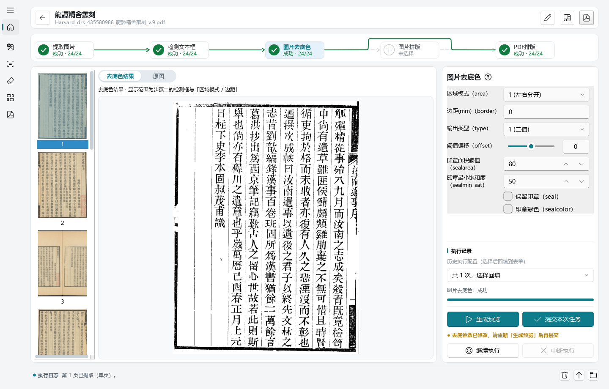

# 古籍重制（gujitools）

**古籍扫描件重制工具**：把发黄、发黑、带着影印痕迹的古籍扫描 PDF，
重新做成干净、可打印的新 PDF。整个流程五步走：

**PDF图片提取 → 检测文本框 → 图片去底色 → 图片拼版 → PDF排版**

---

## 下载程序

下载 `guji_setup_*.exe`（两种模式一体，依赖已内置，装上就能用）：

👉 **[Windows 安装包](https://github.com/zunkun/gujitools/releases/latest)**

- 系统要求 **Windows 10 (1809) 及以上 / Windows 11**，64 位
- 装好后：开始菜单「古籍重製」进桌面端；命令行 `guji` 自动加入 PATH

## 两种使用模式

|      | 桌面端（GUI）                            | 命令行（CLI）                   |
| ---- | ---------------------------------------- | ------------------------------- |
| 启动 | 开始菜单「古籍重製」                     | 终端 `guji <命令>`              |
| 适合 | 手工逐本处理，看预览、手绘修正、拼版拖摆 | 批量处理、脚本集成、无界面环境  |
| 参考 | [桌面端参考](docs/guide/user-guide.md)   | [桌面端参考](docs/guide/cli.md) |

> 拼版目前只在桌面端提供；
> 命令行覆盖 提取 / 检测 / 裁剪 / 去底色 / 生成PDF 五个命令。

## 桌面程序

### 创建任务

本软件可以将处理一本书作为一个任务，任务流程是 **PDF图片提取 → 检测文本框 → 图片去底色 → 图片拼版 → PDF排版**， 也可以自定义流程。

如下导入古籍PDF文件，即可创建一个古籍处理任务。

### PDF图片提取（extract）

从古籍PDF中批量提取图片，可以按照配置相关参数提取图片。

### 检测文本框（detect）

使用YOLO 模型自动找出每页的**左右文本框**（双栏对开）或整页框，坐标可人工校正：

拖动、缩放、删除、空白处手绘补充，框类型（左框/右框/整幅）自动判定。

右侧统计面板按页面形态给全书分类计数，哪页没检出框一目了然。

### 图片去底色（rembg）

自动去除古籍图片发黄发黑的底色，得到干净的黑白（或灰度）正文 **红色印章可保留**。

「区域模式」决定取哪块区域：左右分开 / 合并单图 / 整页合并 / 整页，配合页边距精细控制。先「生成预览」检查效果，满意再「提交本次任务」。

### 图片拼版（拼图）⭐

古籍扫描常见「一页拍两页」。**拼版把两张成品图重新拼回一页**：

序号在前的排在右侧、序号大的排在左侧，贴合古籍从右往左的阅读顺序。

每页可拖动、缩放、旋转（红色中线做基准），画布上所见即所得，拼好的版面直接进 PDF。

如果图片需要调整，还可以对图片进行编辑，使其适合拼版。

**自动拼版**

本软件可以从指定某一张开始，自动完成拼版。

**拼版效果**

**图片微调编辑**

### PDF排版（print）

将排版或者去底色的图片按照参数排版成PDF中每一页，可设置参数包括

- 打印纸张：A4/A3/A5/B5、横竖版、
- 横竖版
- 页边距
- 每页标题
- 每页页码 （中文数字/阿拉伯/干支，生僻字自动补字体）
  。

版面可逐页拖拽微调，参数改了预览立刻跟着变，满意再出成品。

---

## 相关文档

1. [用户操作手册](docs/guide/user-guide.md)
2. [命令行手册](docs/guide/cli.md)
