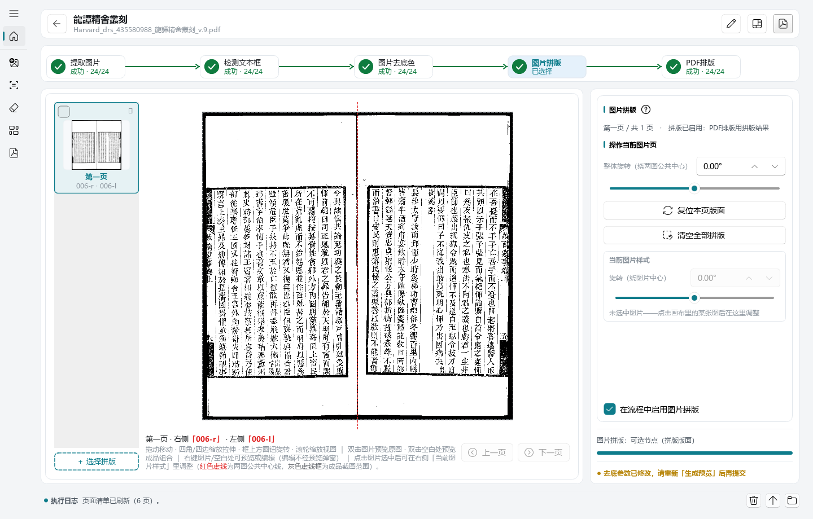
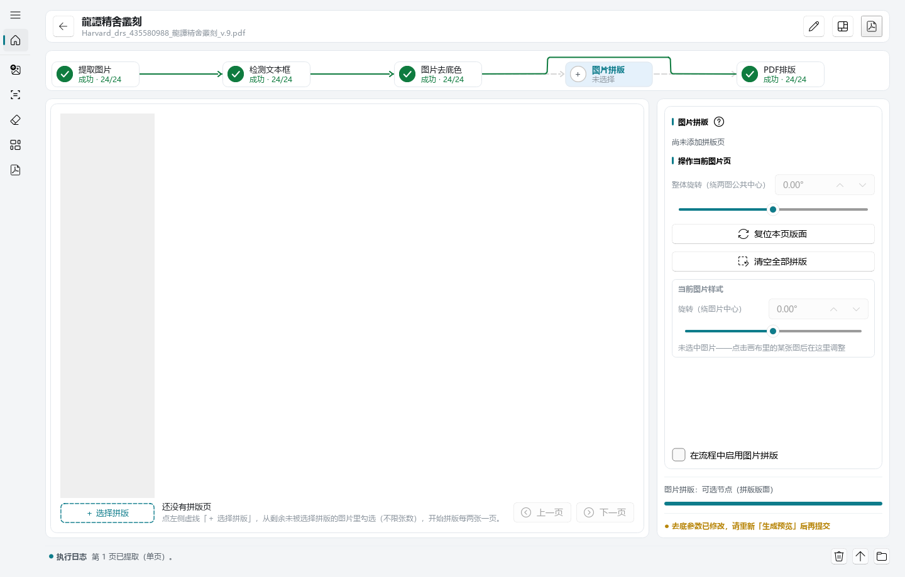

# 古籍重製（gujitools）

**古籍扫描件重制工具**：把发黄、发黑、带着影印痕迹的古籍扫描 PDF，
重新做成干净、可打印的新 PDF。整个流程五步走：

**图片提取 → 检测文本框 → 图片去底色 → 图片拼版 → 生成PDF**

流程可以自定义：创建任务时在流程图上增删步骤、调整顺序（如只做
「去底色 → 生成PDF」），保存时自动校验合法性。

程序安装后的显示名称与开始菜单项为**古籍重製**。

---

## ① 图片提取（extract）

把扫描 PDF 逐页渲染成图片，作为后续所有步骤的输入。支持批量提取全部页、
指定页码范围，优先直接取 PDF 内嵌原图（更快、更清晰），中断后可续跑补缺页。

## ② 检测文本框（detect）

YOLO 模型自动找出每页的**左右文本框**（双栏对开）或整页框，坐标可人工校正：
拖动、缩放、删除、空白处手绘补充，框类型（左框/右框/整幅）自动判定。
右侧统计面板按页面形态给全书分类计数，哪页没检出框一目了然。

## ③ 图片去底色（rembg）

Otsu 二值化去掉发黄发黑的底色，得到干净的黑白（或灰度）正文，**红色印章可保留**。
「区域模式」决定取哪块区域：左右分开 / 合并单图 / 整页合并 / 整页，配合页边距
精细控制。先「生成预览」检查效果，满意再「提交本次任务」。

## ④ 图片拼版（拼图）⭐

古籍扫描常见「一页拍两页」。**拼版把两张成品图重新拼回一页**：
序号在前的排在右侧、序号大的排在左侧，贴合古籍从右往左的阅读顺序。
每页可拖动、缩放、旋转（红色中线做基准），画布上所见即所得，
拼好的版面直接进 PDF。

## ⑤ 生成PDF（print）

把成品图片按你的顺序排上纸面：A4/A3/A5/B5、横竖版、页边距、竖排标题与页码
（中文数字/阿拉伯/干支，生僻字自动补字体）。版面可逐页拖拽微调，参数改了
预览立刻跟着变，满意再出成品。

---

## 两种使用模式

| | 桌面端（GUI） | 命令行（CLI） |
| --- | --- | --- |
| 启动 | 开始菜单「古籍重製」 | 终端 `guji <命令>` |
| 适合 | 手工逐本处理，看预览、手绘修正、拼版拖摆 | 批量处理、脚本集成、无界面环境 |
| 参数 | 表单填写，历史参数自动回填 | 命令行参数或 `guji.yaml` 配置文件 |

> 拼版目前只在桌面端提供；命令行覆盖 提取 / 检测 / 裁剪 / 去底色 / 生成PDF 五个命令。

## 下载（Windows）

**不用装 Python。** 打开最新版 Release 页面，下载 `guji_setup_*.exe`
（约 192 MB，两种模式一体，依赖已内置，装上就能用）：

👉 **[Windows 安装包](https://github.com/zunkun/gujitools/releases/latest)**

- 系统要求 **Windows 10 (1809) 及以上 / Windows 11**，64 位
- 装好后：开始菜单「古籍重製」进桌面端；命令行 `guji` 自动加入 PATH

## 文档

| 想做什么 | 去哪 |
| --- | --- |
| 照着操作（桌面端 + 命令行，逐步配图） | [用户操作手册](docs/guide/user-guide.md) |
| 查命令行全部参数 | [命令行手册](docs/guide/cli.md) |
| 了解代码架构、参与开发 | [开发文档](docs/dev/readme.md) |
| AI 助手 / 新人上手仓库 | [AGENTS.md](AGENTS.md) |
