# 用户操作手册

> 写给**日常使用者**：不需要懂 Python、命令行参数语法或项目结构，照着做即可。
> 开发者文档见 [`docs/dev/`](../dev/readme.md)。

程序有**桌面端**与**命令行**两种模式，算法相同、结果一致：

| 模式              | 适合                                     | 在哪学                                      |
| ----------------- | ---------------------------------------- | ------------------------------------------- |
| **桌面端（GUI）** | 手工逐本处理，看预览、手绘修正、拼版拖摆 | 本手册第一部分                              |
| **命令行（CLI）** | 批量处理几十本、脚本 / 定时任务          | 本手册第二部分；完整参数见 [cli.md](cli.md) |

> ⭐ **重点功能：图片拼版（拼图）**——古籍扫描常见「一页拍两页」，拼版把两张
> 成品图重新拼回一页（序号在前的在右、序号大的在左，贴合古籍从右往左阅读）。
> 详见第 5 节。

桌面端流程：**① 提取图片 → ② 检测文本框 → ③ 图片去底色 → ④ 图片拼版（可选）→ ⑤ 生成PDF**。
每步满意再走下一步；中断后点「继续执行」只补没做完的部分。

> 本手册截图取自真实古籍《龍譚精舍叢刻》v.9（演示页为第 6 页）。

---

# 第一部分：桌面端

安装版从**开始菜单「古籍重製」**启动。任务数据保存在 `~/Documents/guji`，
按任务号（`0001`、`0002`…）分目录存放；删除任务即删除对应目录。

## 0. 顶部菜单：文件 / 单任务 / 帮助

菜单在**窗口标题栏上**（和「古籍重製」标题同一排，不另占一行），也可以用键盘
<kbd>Alt</kbd> 加括号里的字母唤起：

| 菜单          | 菜单项                                                   | 作用                                                         |
| ------------- | -------------------------------------------------------- | ------------------------------------------------------------ |
| **文件(F)**   | 新建任务(N)                                              | 打开「创建任务」页（与任务列表页的「创建任务」按钮同一处）    |
|               | 快速任务(Q)                                              | 直接选一个 PDF 就建任务（任务名用 PDF 文件名、流程用默认），建完进任务详情 |
|               | 退出(X)                                                  | 退出程序（会先收尾正在后台运行的任务）                        |
| **单任务(S)** | PDF图片提取 / 检测文本框 / 图片去底色 / 图片拼版 / PDF排版 | 直接切到对应的独立任务页，等同左侧导航栏里的同名条目          |
| **帮助(H)**   | 帮助文档(D)                                              | 用浏览器打开本手册（与任务列表页的「使用手册」按钮相同）      |
|               | 检查更新(U)                                              | 联网查最新版本，弹窗告诉你是「已是最新」还是「发现新版本」    |
|               | 关于(A)                                                  | 显示程序版本、数据目录与项目地址                              |

> **程序每次启动都会在后台悄悄查一次更新**：查到新版本时，菜单里这一项会变成
> 「检查更新 · 有新版本」（鼠标悬停能看到是哪个版本），点它就能看详情并下载；
> 已经是最新或没查到（断网等）都**不会打扰你**、也不会弹任何窗。
>
> 手动点「检查更新」时会**先弹一个「正在检查」窗**（等不及可以点「取消」——取消后
> 这次结果就不再弹了）；因为 GitHub 在国内经常连不上，检查时会**同时测四条线路**
> （直连 + 三个 gh-proxy 镜像站），**自动挑最快的那条**去查、并把下载地址也拼成
> 这条线路的；结果窗里会写明这次走的是哪条、用了多久，觉得不合适可以点
> 「**换条线路**」换一条镜像。四条都不通时会明确说"直连与三个镜像都试过一遍了"，
> 不会假装已是最新。启动那次后台检查若正好还在跑，你点菜单会**直接接管它**
> （挂上检查窗、结果照常弹），不会让你白等一次。

## 1. 创建任务

**任务列表**

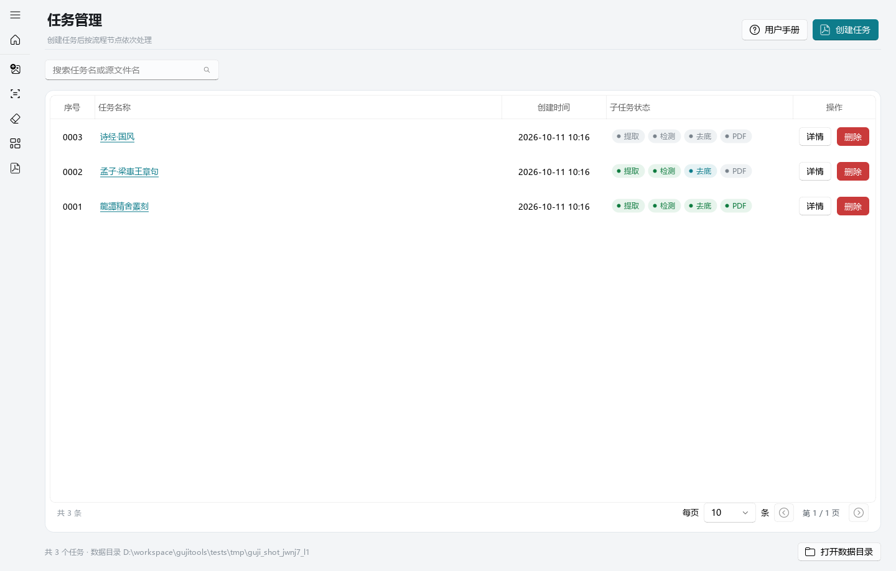

**创建任务**

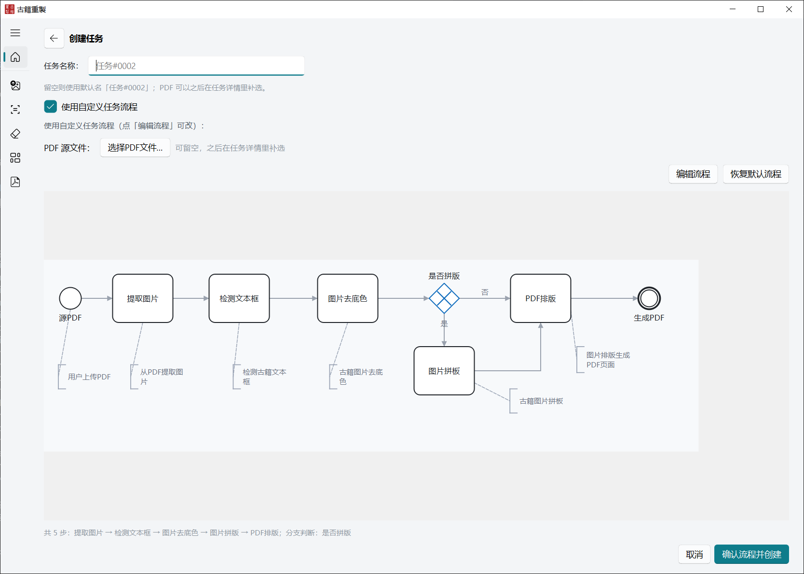

1. 点右上角 **「创建任务」**：填任务名（留空用 PDF 文件名）、选 PDF（可先不选，之后随时补）；
2. 选了与已有任务相同的 PDF，程序会提醒，不会重复占空间；
3. 列表里每个任务有 4 个状态胶囊（提取 / 检测 / 去底 / PDF）：
   **灰=未执行、蓝=执行中、绿=已完成、红=失败**；
4. 点任务名或「详情」进入操作页；「删除」连同全部中间产物一起清理。

> **想省事**：菜单 **文件 → 快速任务**，选好 PDF 就直接建任务——任务名就用
> **PDF 文件名**（与创建页选完 PDF 后自动填进去的那份一模一样）、不用看流程
> （用默认流程），建完直接进任务详情页。想改名去详情页页头的铅笔按钮。
> 第 2 条那句同样的 PDF 提醒仍然会弹，不会因为"快"就跳过。

### 自定义任务流程

创建任务页里可以**编辑流程图**，按这本书的实际情况组装步骤（比如跳过提取、
只做「去底色 → 生成PDF」）：

**创建任务页的流程图（默认流程）**

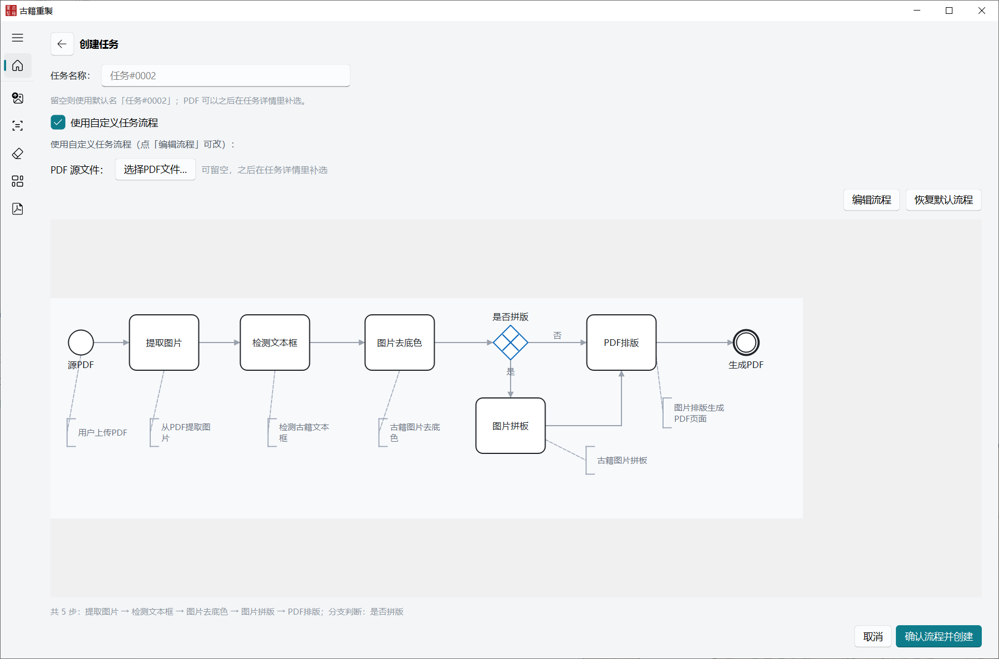

- **加步骤**：从左侧面板把节点**拖到画布上**（流程里已有的会置灰）；
- **连线**：点工具栏「连线」→ 点起点节点 → 点终点节点；点空白处可选中连线，
  「重命名」给分支写条件（如网关分支的「否」）；
- **改名 / 删除**：**双击节点**改名；选中后工具栏「重命名 / 删除」（或 `Delete` 键）；
- **整理**：点 **「自动排版」** 一键把图铺整齐；想全部撤回点 **「恢复默认」**；
- 编好点 **「保存流程」**——不合法的流程会被当场拒绝（例如「PDF排版」必须
  排在最后、流程里至少要有一个可执行步骤），按提示调整即可；
- 有几条**自动联动**，不用手动清理：「上传 PDF」与「提取图片」成对增删；
  删「PDF排版」时它后面的「生成PDF」结束事件跟着删；依附「图片拼版」的
  「是否拼版」判断也随它一起删（不能单独添加）。

保存后，任务详情页的步骤条就按你的流程渲染，运行顺序由程序按图自动推导。
没有上游产物也能跑（如没做检测就直接去底色，程序按整页处理）。

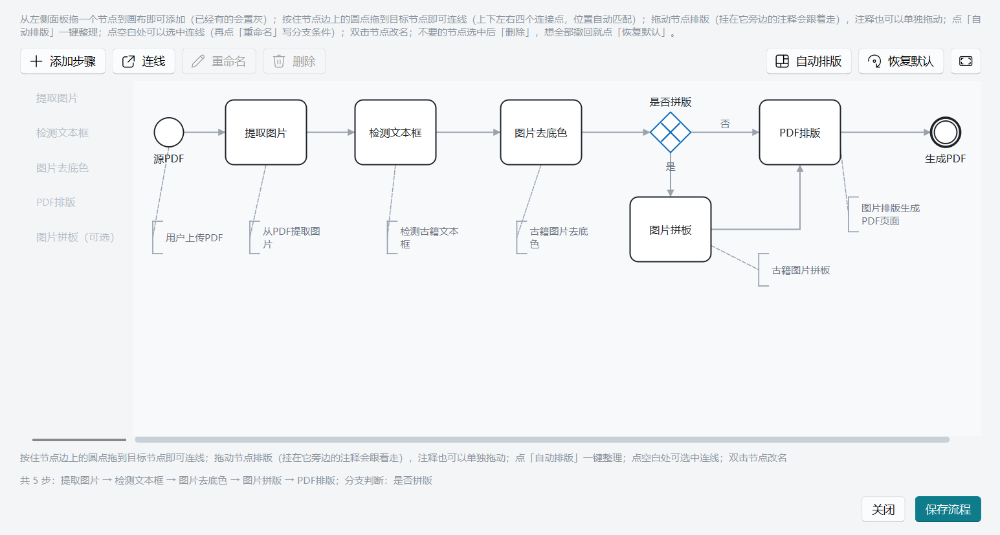

## 2. 第一步：提取图片

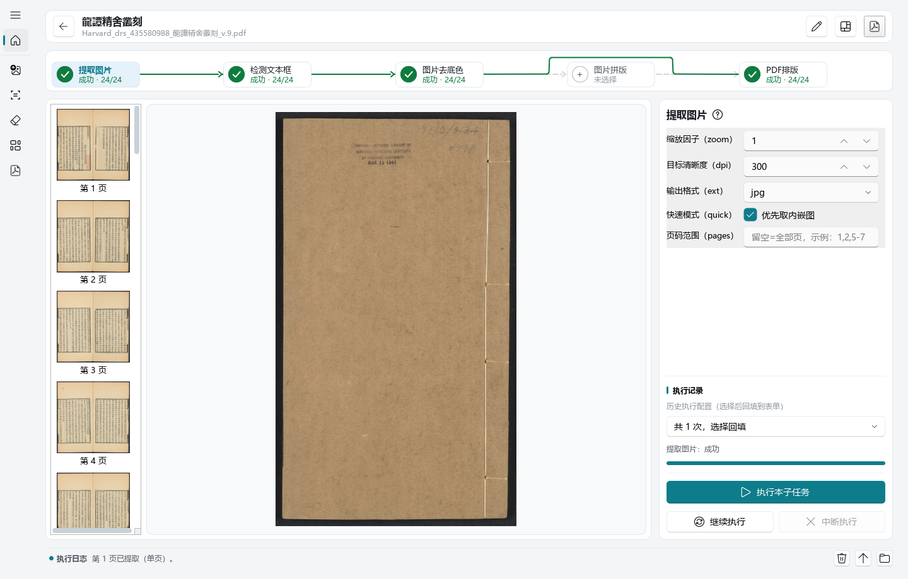

- 左侧预览：翻到哪页就当场提取哪页；右侧调好参数点 **「执行本子任务」** 批量提取全部页；
- 常用参数：**缩放因子（zoom）**（默认 1，字小用 2）、**输出格式（ext）**
  （黑白古籍 `jpg` 足够）、**页码范围（pages）**（试跑前几页时填，如 `1,2,5-7`）；
  **目标清晰度（dpi）** 保持默认 300，**快速模式（quick）** 保持勾选即可；

- 中断了？点 **「继续执行」** 只补没提取的页。

## 3. 第二步：检测文本框

自动找出每页的**左右文本框**（双栏对开）或整页框，供后两步裁剪与去底色使用。

**检测完成：左右框已标出，右侧是全书统计**


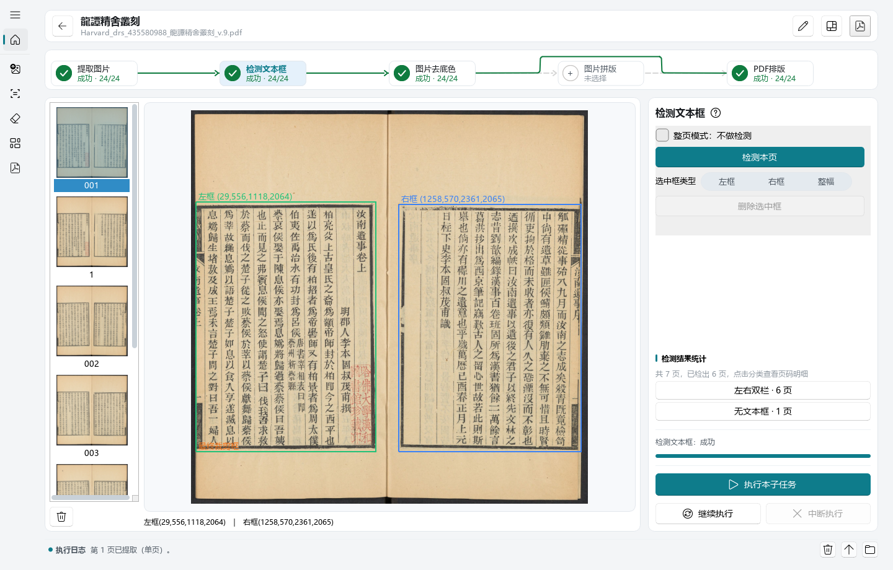

- 进入本步**不自动检测**：点 **「检测本页」** 或 **「执行本子任务」**（全部页）；
- 不是双栏古籍？勾 **「整页模式：不做检测」**，整页即唯一文本框；
- **「检测结果统计」** 按页面形态给全书分类计数，点分类列出页码、点页码直接跳页。

### 校正检测框


- **框内拖动**=移动；**拖四角小方块**=缩放；**选中按 `Delete`**=删除；
- **空白处拖拽**=手绘补充新框（手动框不会被自动检测覆盖）；

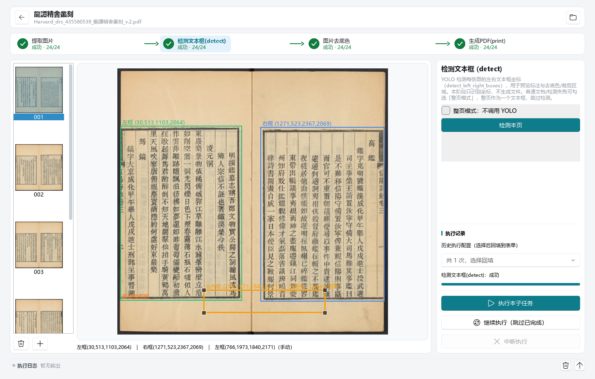

- 左框/右框由**中心位置**自动判定，拖动后会自动互换；整页只有一个内容区时
  把框设为**整幅**（与左右框互斥，会自动清掉多余框）；
- 某页一个框都没检出（封面、扉页）是**正常**的，不是报错。

## 4. 第三步：图片去底色

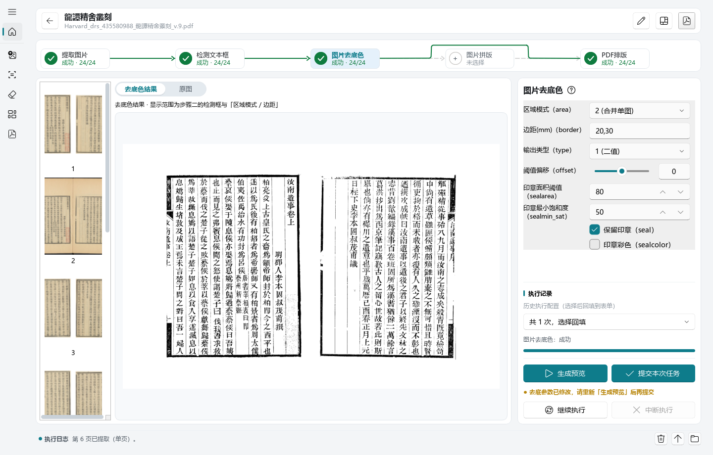

把底色去掉，得到干净的黑白正文。**「区域模式 / 边距」在这一步**：

| 区域模式（area）  | 效果                                               |
| ----------------- | -------------------------------------------------- |
| `1 (左右分开)`    | 左右各出一张图，分别处理（**最常用**，拼版的前提） |
| `2 (合并单图)`    | 左右合成一张，保留原页尺寸                         |
| `3 (整页合并)`    | 左右框并成一个大框整页处理                         |
| `4 (整页/不检测)` | 整页即唯一文本框，适合普通文档                     |

- **边距(mm)（border）**：在框之外多留多少白边（类似页边距），留空=裁到框边界；
- **输出类型（type）**：`1 (二值)` 纯黑白 / `3 (灰度)` 保留灰度过渡；
  **阈值偏移（offset）** 正数文字更粗更深、负数更细更淡，一般保持 0；
- 勾 **保留印章（seal）** 保留红色印章；勾 **印章彩色（sealcolor）**
  在检出印章时输出彩色 PNG；
- **务必按顺序点两个按钮**：先 **「生成预览」** 检查效果 → 满意再 **「提交本次任务」**。
  改了参数后程序会提示「**去底参数已修改**，请重新「生成预览」后再提交」，
  此时「提交」变灰——这是防止你用旧预览提交了新参数。

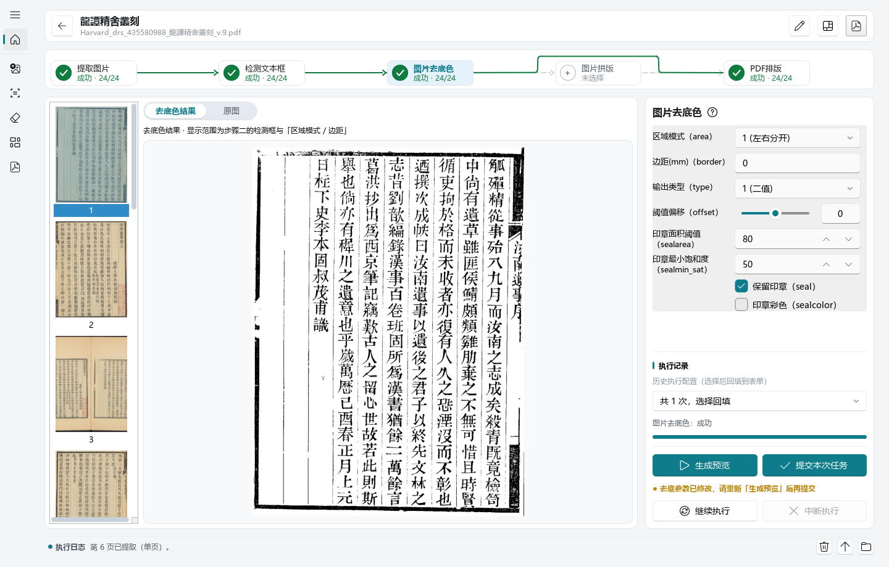

## 5. 第四步（可选）：图片拼版（拼图）⭐

**重点功能**。把左右两个半页**重新拼回一页**：序号在前的排在右侧、
序号大的排在左侧（贴合古籍从右往左阅读）。不需要设纸张，图怎么摆、
摆多大都由你定。

**自动拼版**

本软件可以从指定某一张开始，自动完成拼版。

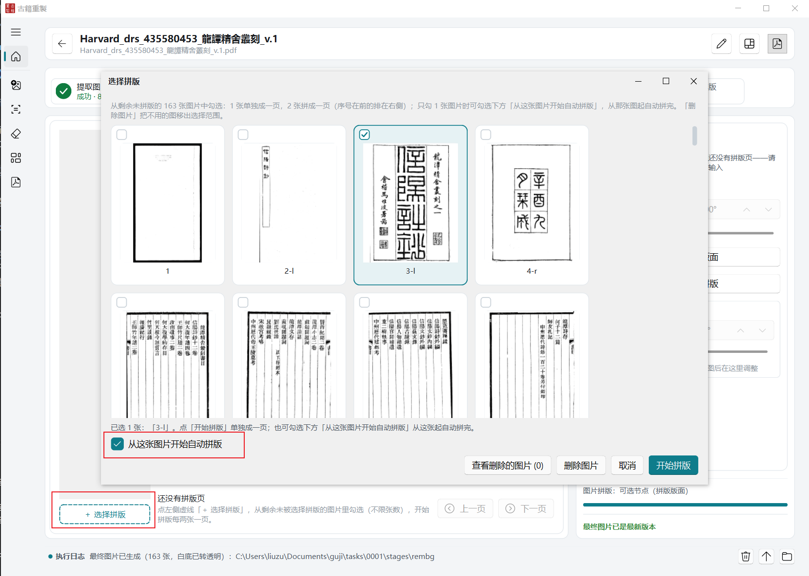

**拼版效果**

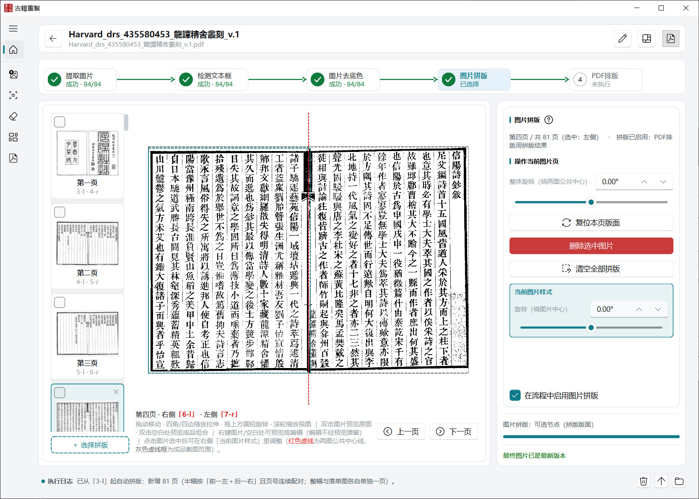

> 只有第三步「区域模式 = 1（左右分开）」时，流程条上才会出现虚线的
> **「图片拼版」** 节点；拼出第一页时程序自动帮你启用它。

**怎么拼：**

1. 点流程条上的 **「图片拼版」** 节点进入拼版页；
2. **弹窗选择拼版图片**：点最后一格 **「＋ 选择拼版」**，弹窗以卡片网格列出
   还没被用过的成品图（每张卡片 = 缩略图 + 文件名）；**点整张卡片即可勾选**
   （左上角出现对勾），勾选**两张**后点「确定」——序号在前的那张自动排到右边；
3. **调整版面**：点击某张图选中（带细虚线），**拖动**移位、**拖四角**缩放
   （按住 `Shift` 等比）、拖**四条边**单独拉伸、拖图上方的**圆钮**旋转
   （按住 `Shift` 吸附 15°）；右侧面板可**整体旋转**整页、**复位本页版面**
   或**删除本页拼版**；
4. **移动拼版页序**：在左侧列表里**按住某一页上下拖**，顺序就是最终 PDF 的
   页序；画布下方 **「上一页 / 下一页」** 翻页；勾选多页左上角的勾选框可
   **「批量删除」**（删除都会先弹窗确认）；
5. **双击图片**编辑整页拼版，**双击空白处**预览整页成品。

### 在拼版页编辑图片（微调）

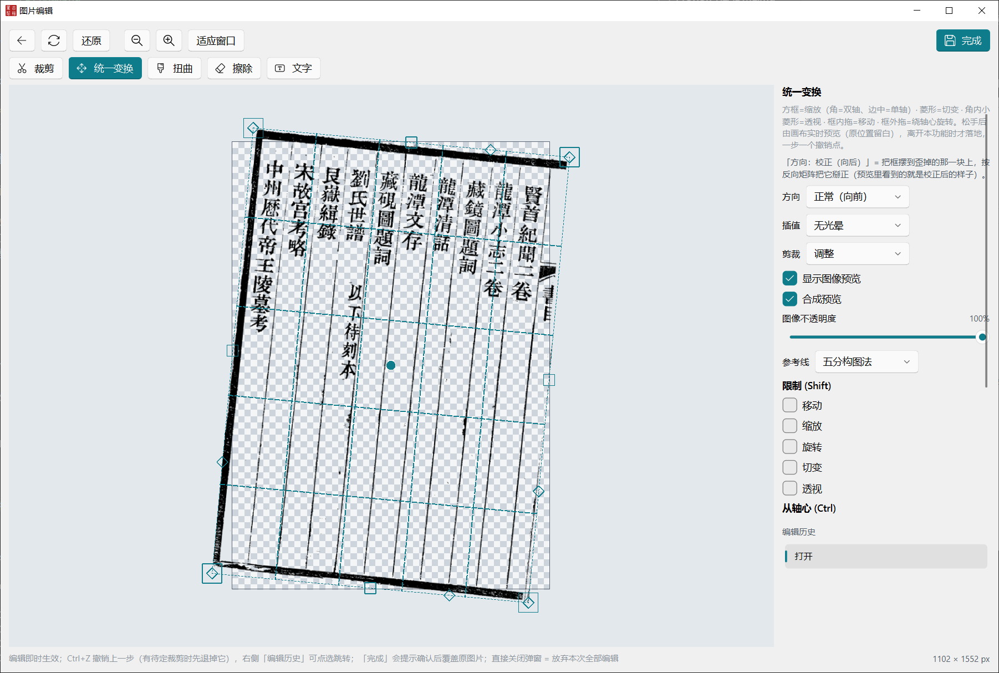

某一张图上还有瑕疵（污点、歪斜、想去掉一块），不必退回第三步重跑——
右键拼版画布上的图片或空白处，选 **「编辑图片」**（也可双击图片），
直接进入整页编辑器。左右两张源图会同时显示在同一画布上；点击任一图片即可
切换活动图片，裁剪、变换、擦除等操作只作用于当前图片，两张图片的相对位置
也会保留。拼版整页编辑器不提供文字工具，其他步骤的单图编辑功能不变：

- 点 **「完成」** 后，有修改的图片分别覆盖回各自源文件，未修改的图片不变；
  调整过的图片位置与尺寸也会写回拼版版面，本页成品随之重新合成；
- 右键菜单中的 **「预览图片」** 只看不改（图上预览单张原图，空白处预览整页）。

在其他步骤的图片编辑器中，使用**裁剪**工具时也可直接拖动框内图片；裁剪框与
图片一起移动。应用后画布会扩展，并以透明边距保留位移，保存到实体图片。

> 画面上恒显的**红色中线**是旋转基准（整版怎么转它都不动）；**灰色虚线框**
> 就是成品范围——框里有什么，PDF 里就是什么。

**启用与不启用**：面板底部 **「在流程中启用图片拼版」** 勾上 = 第五步改用拼版
结果；不勾则用第三步的去底色图。拼版页全部删光也仍算启用；想改回去底色图
请取消勾选。换过取图来源后，重新点一次「生成PDF」即可。

## 6. 第五步：PDF排版

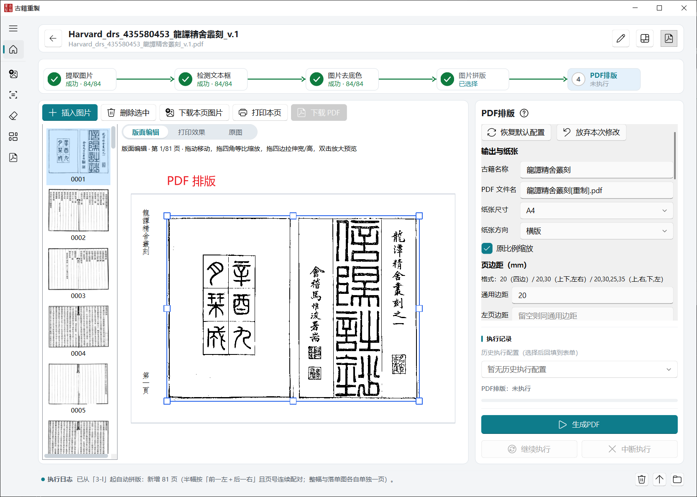

- 左侧待打印缩略图条：**拖动排序**、`Delete` 删除、**「插入图片」** 引用外部文件；
- 中间版面编辑器：**直接拖动图片移动、拖四角缩放**（默认保持原比例不变形），
  坐标按页记住，出 PDF 严格照此排——所见即所得；
- 参数改一下，预览立刻跟着变；确认后点 **「生成PDF」** 出成品。

常用参数：

| 参数        | 说明                                                                      |
| ----------- | ------------------------------------------------------------------------- |
| 古籍名称    | 填了自动推导 PDF 文件名（源文件名 + `[重制]`）                            |
| 纸张 / 方向 | A4/A3/A5/B5；**竖开本古籍记得选「竖版」**（默认横版，不改会两侧大片空白） |
| 页边距      | `20` 或 `20,30` 或 `20,30,25,35`（毫米）                                  |
| 标题 / 页码 | 勾选后可设字体、字号、样式；标题恒在上、页码恒在下，都是竖排              |

- 页码样式：**中文数字**（第五）/ **阿拉伯数字**（5）/ **干支**（甲子），
  前后缀可改（默认「第…頁」）；
- 字体默认「自动（仿宋优先）」，**生僻字不会排成空白**——缺字时程序自动用
  系统其它字体补上；
- 分清两个按钮：**「下载 PDF」** 出整本成品；**「下载本页图片」** 只导出当前页
  （300dpi，可直接打印）。

## 7. 图片预览与编辑

- 预览区**双击**放大：滚轮缩放、拖动平移、双击在「适应窗口 / 100%」间切换，
  快捷键 `←` `→` 翻页、`Esc` 关闭；
- **右键图片 →「编辑图片」**：直接进图片编辑器（裁剪 / 变换 / 微调 / 变形 /
  擦除 / 插入文字）。**「完成」= 覆盖回这张图对应的真实文件**，会顺着流程
  传到后面的步骤、最终进 PDF；
- 例外：**第三步「图片去底色」只许预览、不许编辑**（结果由参数算出）。

## 8. 独立任务页：不用建任务，选了就能跑

左侧导航还有五个**独立任务页**：**PDF图片提取 / 检测文本框 / 图片去底色 /
PDF排版 / 图片拼版**——临时处理一两张图、一个小册子时用。

1. 把文件或文件夹**拖进输入区**；
2. 调参数（与任务流程里同名步骤完全相同）、看预览；
3. 点执行，产物自动输出到源文件旁边（如 `<PDF 名>_提取/`、`<源名>_去底/`）。

独立页与任务流程**数据不相通**，参数也不跨会话记忆；「图片拼版」页拖入图片后
可「自动拼版」按文件名配对，或手动选两张，摆好后点「导出成品」。

## 9. 日志与排查

底部常驻**状态条**显示最近一条输出，点开是完整**日志浮层**（执行时自动展开、
出错标红）：

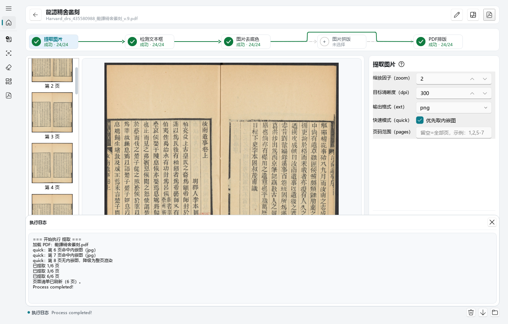

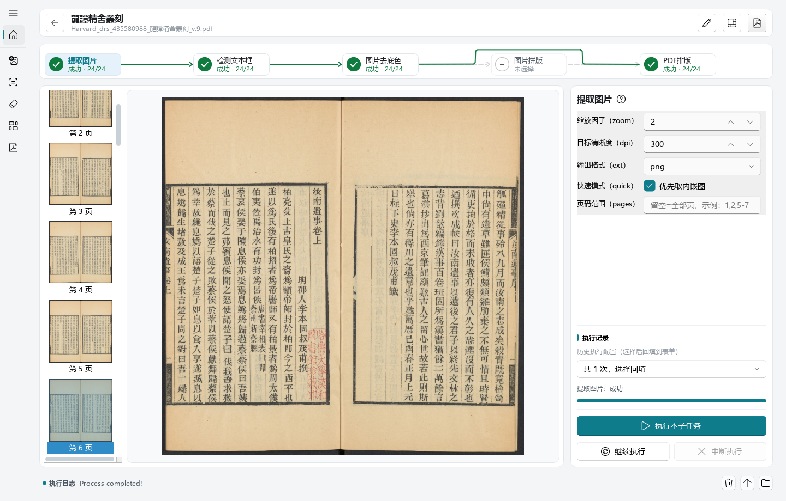

| 现象                         | 处理                                              |
| ---------------------------- | ------------------------------------------------- |
| 第二步预览没有框             | 本步不自动检测：点「检测本页」或「执行本子任务」  |
| 第三步「提交」是灰的         | 参数改过还没重新「生成预览」                      |
| 出 PDF 后两侧空白很大        | 竖开本古籍忘了把「纸张方向」改成**竖版**          |
| 提取结果缺页                 | 点「继续执行」补缺失页                            |
| 某一步胶囊变红               | 打开日志浮层看红字原因，修正后重跑该步            |
| 流程条上没有「图片拼版」节点 | 第三步「区域模式」改成 `1（左右分开）`            |
| 拼好了但 PDF 还是去底色的图  | 「在流程中启用图片拼版」没勾；勾上重新「生成PDF」 |
| 拼版弹窗里可选的图很少       | 只列还没被用过的图；先「删除本页拼版」放回来      |

---

# 第二部分：命令行（CLI）

批量处理、脚本 / 定时任务用命令行。安装版重开终端后 `guji` 即可用。

```bash
guji init                          # 1. 首次：交互式生成 guji.yaml 配置文件

# 2. 按配置文件依次执行（每个命令读 guji.yaml 里同名配置块）
guji run extract                   #    从 PDF 提取图片
guji run crop                      #    裁剪文本框
guji run rembg                     #    去底色
guji run print                     #    生成 PDF（只能这样执行）

# 3. 或不用配置文件，直接给参数
guji extract -i book.pdf -o ./images --zoom 2
guji cropremove -i ./images -o ./output --area 1   # 裁剪+去底色一步完成
```

- `cropremove` = 裁剪 + 去底色一步完成，`--area 1` 与桌面端「区域模式 1」含义相同；
- `detect` 不必单独执行（`crop` / `cropremove` 内部已自动检测），它只用于
  单独查看检测结果；
- 通用参数 `-i/--input`、`-o/--output`、`--clean`、`--workers` 对所有命令生效；
- 帮助：`guji help`（概览）、`guji help <命令>`（单命令手册）、`guji -v`（版本）。

👉 全部命令、参数表、`guji.yaml` 写法与退出码见 **[命令行使用说明](cli.md)**；
每个命令的权威手册可在终端用 `guji help <命令>` 直接查看。
